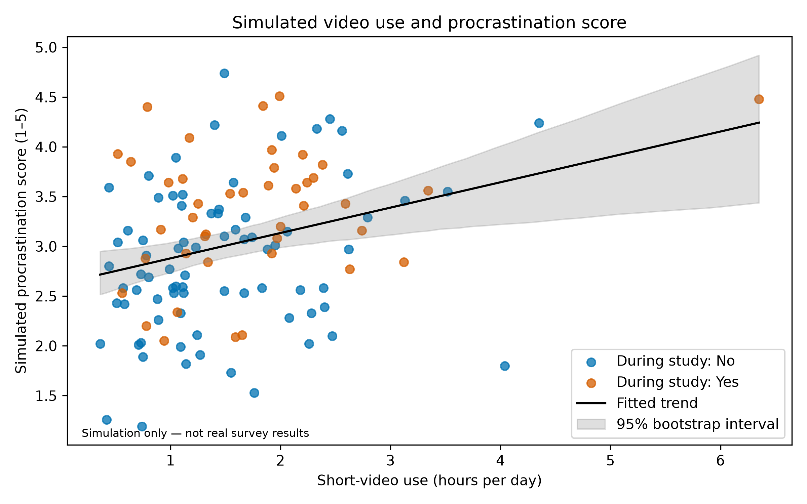
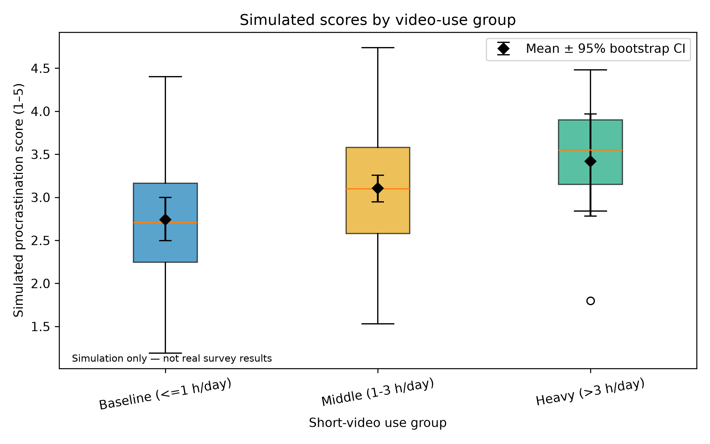

# Short-Video Use and Academic Procrastination

**Authors:** Imatai Sultangali and Myzappar Shyntas

## Project overview

This project demonstrates a reproducible analysis workflow for the question: how is daily short-video viewing time associated with academic procrastination?

**Important:** the current dataset contains 120 simulated records, not responses from real students. The results below describe only this simulation and must not be presented as empirical findings about students.

## Repository contents

- `data/raw/` — simulated input records
- `data/processed/` — cleaned records and summary metrics
- `src/process_data.py` — data cleaning and statistical analysis
- `src/visualize.py` — figure generation
- `notebooks/01_data_analysis.ipynb` — analysis with visible outputs
- `docs/domain_model.md` — domain model
- `reports/task3_report.md` — detailed report
- `reports/figures/` — PNG and PDF figures

## Results and discussion

The simulated dataset contains 120 records. The Pearson correlation between daily video hours and the simulated procrastination score is approximately **r = 0.308** (**p = 0.0006**).

| Simulated viewing group | Records | Mean simulated score |
|---|---:|---:|
| Baseline (up to 1 hour/day) | 32 | 2.741 |
| Middle (over 1 to 3 hours/day) | 81 | 3.104 |
| Heavy (over 3 hours/day) | 7 | 3.419 |

The Welch comparison of the heavy and baseline groups has **p = 0.099**. At the 0.05 significance level, this comparison is not statistically significant.

These results come from artificial data. The data-generation process deliberately creates a positive pattern, so the results do not establish a real relationship among students.

## Figures





PDF versions of the figures are also available in `reports/figures/`.

## Domain model

See [docs/domain_model.md](docs/domain_model.md).

## Reproducibility

Install the required packages:

```bash
python -m pip install -r requirements.txt