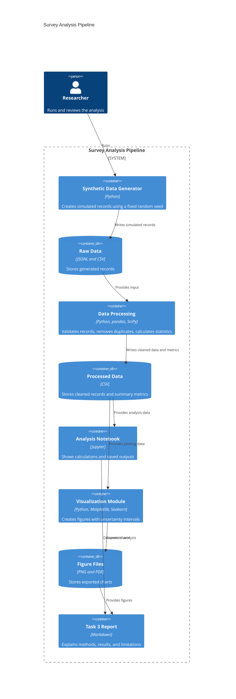

# Domain Model: Short-Video Use and Academic Procrastination

## Scope and data status

This model describes the adapted Task 3 survey-analysis workflow. The current dataset contains simulated records, not real student responses.

## C4 container view

## Variables and measurement point

| Variable | Meaning | Scale or unit |
|---|---|---|
| `daily_video_hours` | Simulated daily short-video viewing time | Hours per day |
| `simulated_procrastination_score` | Simulated procrastination score | Scale from 1 to 5 |
| `during_study` | Simulated video viewing while studying | Yes / No |
| `study_year` | Simulated year of study | 1–4 |

The data are generated by `src/simulate_survey_data.py`. This generator is the data-creation point; it does not collect answers from real students. Timed warm-up filtering is not applicable to this survey-style adaptation.

## Processing and outputs

`src/process_data.py` validates and cleans the records, then writes the cleaned dataset and summary metrics under `data/processed/`.

`src/visualize.py` creates charts and exports them to `reports/figures/` in PNG and PDF formats. The notebook presents the calculations and outputs, while the report explains the analysis.

## Limitations

All observations are simulated. The scores are not validated survey measurements, and the results cannot be used as evidence about real university students.